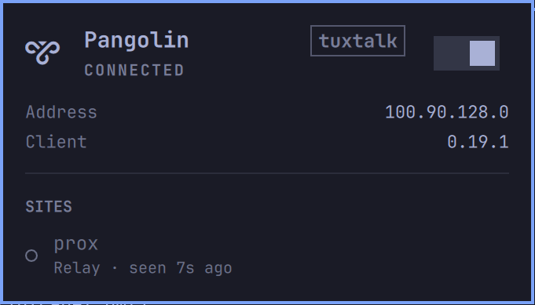

# Pangolin for Omarchy

An Omarchy bar widget for the [Pangolin](https://pangolin.net) client: see at a
glance whether you're connected, turn the client on or off, and check which
sites are reachable (direct or relayed, with latency).

*Unofficial: not made by or affiliated with Fossorial / Pangolin.*



## Requirements

- The [Pangolin CLI](https://docs.pangolin.net/manage/clients/install-client)
  (`pangolin`), on your `PATH` or in `~/.local/bin`.
- Logged in once from a terminal: `pangolin login`, then `sudo pangolin up`
  the first time (the CLI needs root once to cache the device fingerprint).

## Install

```bash
omarchy plugin add https://github.com/ShinobiX9X/omarchy-pangolin.git --enable
```

## Remove

```bash
omarchy plugin remove io.github.shinobix9x.pangolin
```

The plugin writes no files of its own.

## Use

| Action | Result |
|--------|--------|
| Click the icon | Open the popup |
| Middle-click the icon | Connect / disconnect |
| Right-click the icon | Refresh now |
| Switch in the popup, `Enter`, `Space` or `T` | Connect / disconnect |
| `R` in the popup | Refresh now |

The icon is dimmed while disconnected, pulses while connecting, and turns the
theme's urgent color when the client reports an error.

Connecting asks for your password in the Omarchy polkit dialog, because
`pangolin up` creates a network interface as root. Disconnecting needs no
password.

From a script or a keybinding:

```bash
omarchy-shell io.github.shinobix9x.pangolin toggleClient   # or up / down
omarchy-shell io.github.shinobix9x.pangolin status         # on, off, connecting, error, ...
```

### Settings

In the bar settings, or in `~/.config/omarchy/shell.json`:

| Key | Default | Meaning |
|-----|---------|---------|
| `refreshIntervalSec` | `10` | How often the status is read while the popup is closed |
| `hideWhenOff` | `false` | Hide the icon while the client is off |

## How it works

- Status: `pangolin status --json`, which reads the client's local socket.
  Nothing is sent over the network by the widget itself.
- Disconnect: `pangolin down`.
- Connect: `pangolin up --silent`. The CLI starts its root process with
  `sudo sh -c …`, which needs a terminal. The widget puts a small `sudo`
  stand-in ([`elevate/sudo`](elevate/sudo)) first on `PATH` for that one call;
  it accepts only that exact `sh -c` form and hands it to `pkexec`, so you get
  the normal polkit password prompt. Nothing is installed system-wide and no
  sudoers or polkit rules are changed.
- Credentials stay off the process list: on its own, `pangolin up` starts the
  root client with `--id … --secret …` on its command line, readable by any
  local user through `ps`. The stand-in moves those two values into
  `PANGOLIN_CLIENT_ID` / `PANGOLIN_CLIENT_SECRET` (which the CLI reads, and
  which only root can see in `/proc/<pid>/environ`) and passes the script to
  the root shell on stdin. The widget never reads or shows process command
  lines.

Set `PANGOLIN_BIN` in the shell's environment to use a CLI at another path.

## License

MIT
